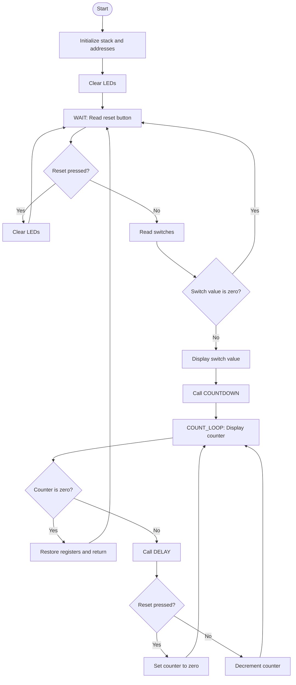

# Lab 10 — Task 1: FSM control flow

## Flowchart

## States and transitions

- **WAIT / wait_state:** Check the reset-button register. If reset is pressed, clear LEDs and remain waiting. Otherwise read switches.
- **READ SWITCHES / read_sw:** If the switch value is zero, return to WAIT. If nonzero, display it and call the countdown routine.
- **COUNTDOWN / count_loop:** Display the current counter. If it is zero, finish. Otherwise run the delay routine.
- **RESET DURING COUNTDOWN:** The delay routine returns 1 when reset is pressed. The countdown sets the counter to zero; the next loop pass writes zero to the LEDs and finishes.
- **COUNT NEXT:** If reset was not pressed, decrement the counter and repeat.
- **RETURN:** Restore saved registers and return to WAIT.

## Address assumptions

- LEDs: `0x200`
- Switches: `0x300`
- Reset-button status: `0x304`, bit 0

The reset register at `0x304` must be implemented in the hardware decoder. In the Lab 8 address map, `0x304` is within the existing switch region; it will not independently report a button unless the decoder/interface is extended.
